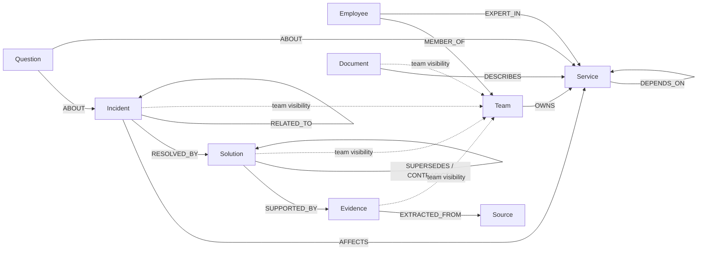

# NexusHelper

**Submission track: Company Brain · Track 03**

NexusHelper is a company knowledge assistant built around a graph of people, teams, services, incidents, decisions, documents, and evidence. It retrieves graph records before asking a language model to explain them, and includes evidence with its answers.

## Submission links

- **Public source repository:** [github.com/NirSen117/NexusHelper](https://github.com/NirSen117/NexusHelper)
- **Live web app:** [nexushelper-3eb6d.web.app](https://nexushelper-3eb6d.web.app)
- **API health:** [NexusHelper API](https://nexushelper-api-263908316387.asia-south1.run.app/health)

The live app requires Firebase sign-in. New company workspaces start with an empty FalkorDB graph; this repository does not yet include document or ticket import connectors. The included graph seed is fictional demo data.

## Graph data model

Each company is assigned a distinct FalkorDB graph. Firestore holds company records, invitations, and memberships; graph knowledge stays in FalkorDB. The creator starts as a company owner and can invite verified email addresses with team scopes and an optional expiry.



Nodes carry identifiers and labels such as service names, incident status, timestamps, confidence, provenance, validity dates, and visibility. `VISIBLE_TO` edges associate restricted records with teams. The canonical schema and fictional seed are in [schema.cypher](schema.cypher).

## Query path and graph operations

The backend’s executable FalkorDB queries are in [app/services/graph.py](app/services/graph.py). The product path is:

1. `classify` in [app/services/router.py](app/services/router.py) uses lightweight rules to choose lookup, contextual, or investigation routing.
2. `match_services` links query text to service aliases and names.
3. `find_documents` and `find_incidents` retrieve related records; `find_owners` and `find_experts` retrieve directory relationships.
4. `find_subgraph` follows incident, service, solution, evidence, and source edges for the answer’s evidence view.
5. `check_verification` checks solution status and supersession/contradiction relationships; [app/services/verifier.py](app/services/verifier.py) checks answer citations against retrieved evidence.
6. [app/services/query_service.py](app/services/query_service.py) assembles the grounded context and trace. Groq is the configured primary model; Gemini is an optional fallback.

[schema.cypher](schema.cypher) also contains the schema, indexes, demo seed, and standalone Cypher examples for permission-scoped retrieval. Vector indexes are declared for future retrieval work; the current request path links services with aliases and uses graph queries rather than vector search.

## Run locally

Requirements: Python 3.11 or later and Node.js 20 or later.

```bash
git clone https://github.com/NirSen117/NexusHelper.git
cd NexusHelper
cp .env.example .env
python -m venv .venv
source .venv/bin/activate
pip install -r requirements.txt
uvicorn app.main:app --reload
```

In a second terminal:

```bash
cd NexusHelper/frontend
npm install
cp .env.example .env
npm run dev
```

Open `http://localhost:5173` and choose **Try demo**. With the example settings, the API uses its synthetic in-memory graph and mock model; Firebase, Groq, Gemini, and a graph server are not needed for this local preview. API documentation is at `http://localhost:8000/docs`.

To use a local FalkorDB instance instead, start one with `docker run --rm -p 6379:6379 falkordb/falkordb:latest`, keep the example host/port in `.env`, then run:

```bash
./.venv/bin/python scripts/setup_local_falkordb.py
```

This loads the fictional sample graph only when the selected graph is empty. Do not load it into a company graph. For Firebase, Firestore, model-provider, FalkorDB Cloud, and deployment setup, see [docs/SETUP.md](docs/SETUP.md).

## Configuration and security

`.env.example` and `frontend/.env.example` contain placeholders only. Keep backend provider and graph credentials in the backend environment or a secret manager; never put them in `frontend/.env`, a `VITE_*` variable, source control, or a desktop package. Firebase web configuration is public client configuration; authorization is enforced by the backend using verified Firebase identity and Firestore membership records.

## Known submission limits

- The live UI/API are deployed, but company data ingestion from documents, tickets, or chats is not implemented yet.
- Newly created company graphs are empty until data is loaded through a future ingestion workflow.
- Installers are not published; use the local setup above for the desktop wrapper’s development preview.

## License

All rights reserved. No license is granted to use, modify, or redistribute this project.
